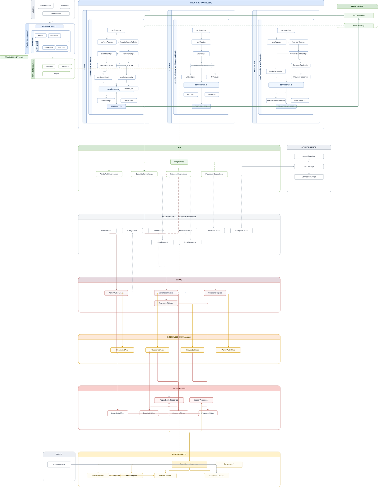
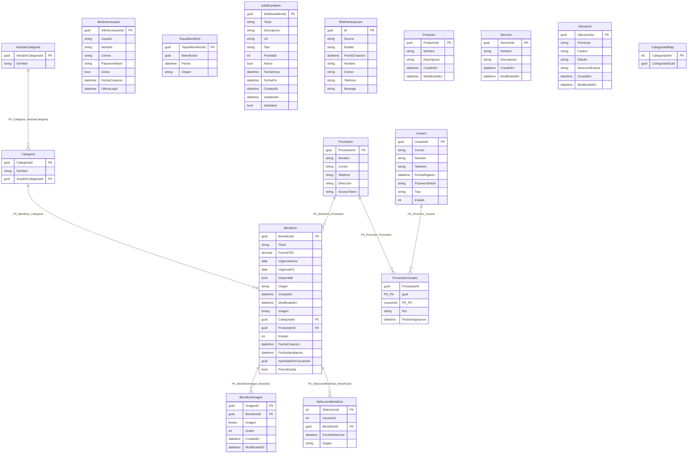

# HR-Beneficios

## Arquitectura del sistema

  

## Documentación por módulos

El proyecto está documentado de forma modular. Cada componente contiene su propio README con detalles técnicos y de ejecución.

### Backend

* `api/README.md` → API principal, lógica de negocio y acceso a datos

### Base de datos

* `BD/README.md` → scripts SQL, estructura y seeds iniciales

### Herramientas

* `tools/README.md` → utilidades del proyecto
* `tools/HashGenerator/README.md` → generación de hashes BCrypt

### Frontend (desarrollo - Vite)

* `clon/AdminBeneficiosFinalPublicado/README.md` → portal de administración
* `clon/BeneficiosFinalPublicado/README.md` → portal de colaboradores
* `clon/ProveedorBeneficiosFinalPublicado/README.md` → portal de proveedores
* `clon/InicioBeneficiosFinalPublicado/README.md` → landing principal

### Frontend (despliegue / hosts ASP.NET)

* `webAdmin/README.md` → host del portal admin
* `webClient/README.md` → host del portal de colaboradores
* `webProveedor/README.md` → host del portal de proveedores
* `webInicio/README.md` → host del landing
* `web/README.md` → artefacto no ejecutable directamente (ver detalles internos)

### Configuración

* `.github/README.md` → configuración de repositorio (actualmente sin workflows)

## Flujo general del sistema

1. El usuario accede a un frontend (Admin, Proveedor o Cliente)
2. El frontend consume la API mediante endpoints `/api/...`
3. La API procesa la solicitud (lógica de negocio)
4. Se accede a la base de datos mediante procedimientos almacenados
5. La respuesta se devuelve al frontend

## Consideraciones importantes

* La API y los frontends deben estar alineados en el mismo endpoint base (`API_BASE`)
* Existen diferencias entre entorno de desarrollo (Vite proxy) y despliegue (ASP.NET host)
* El módulo `web/` no es ejecutable directamente (solo artefactos generados)
* El portal de proveedor utiliza configuración directa de API (no proxy)

## Inicio rápido

1. Ejecutar base de datos (`BD/README.md`)
2. Levantar API (`api/README.md`)
3. Ejecutar frontend desde `clon/` según módulo

## Modelo de datos

